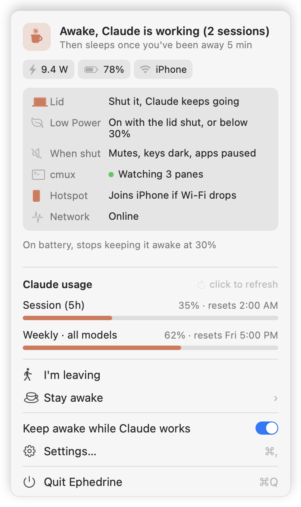
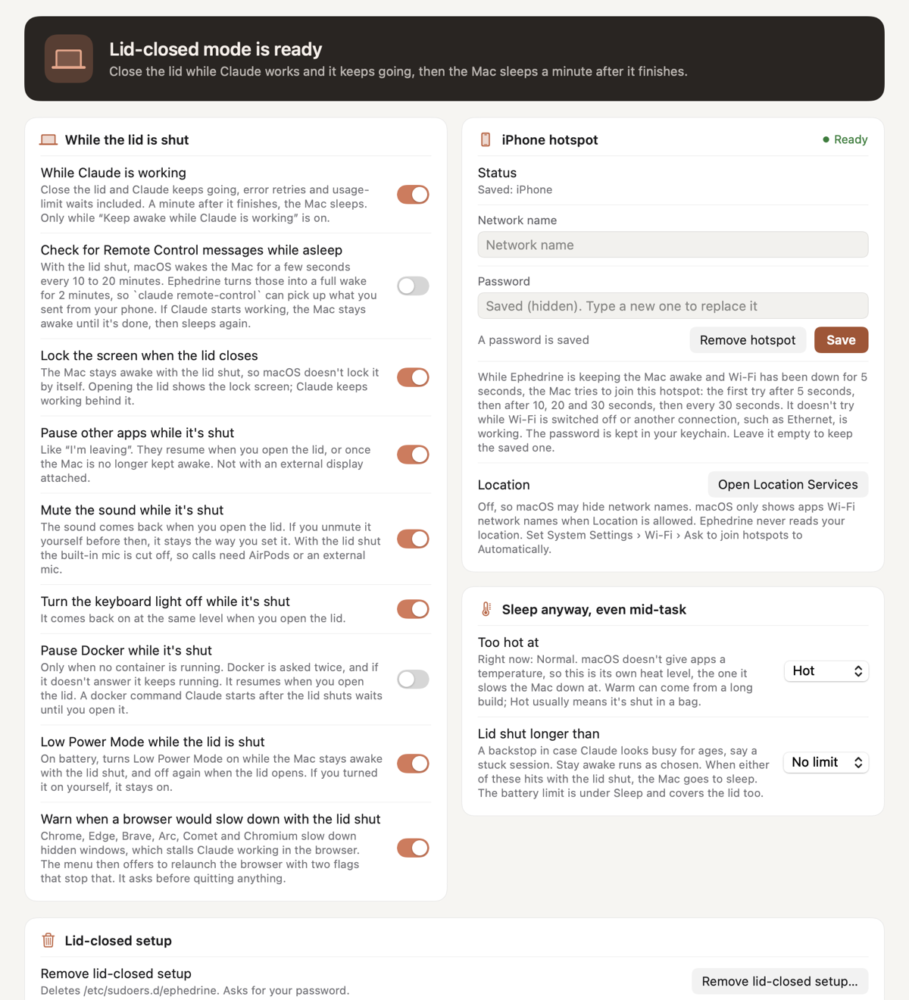

<p align="center">
  
</p>

<h1 align="center">Ephedrine</h1>

<p align="center">A menu bar app that keeps your Mac awake while Claude Code is working, then lets it sleep once Claude is done and you've walked away.</p>

<p align="center">
<a href="https://github.com/3xyy/ephedrine/actions/workflows/ci.yml"></a>
<a href="https://github.com/3xyy/ephedrine/releases"></a>
<a href="https://github.com/3xyy/homebrew-tap"></a>
<a href="#install"></a>
<a href="Package.swift"></a>
<a href="LICENSE"></a>
</p>

<p align="center">
  <a href="#install">Install</a> ·
  <a href="#features">Features</a> ·
  <a href="#how-it-works">How it works</a> ·
  <a href="#faq">FAQ</a>
</p>

<p align="center">
  
  &nbsp;&nbsp;
  
</p>

## Why

I wanted to start a long Claude Code task, close the lid, and come back to finished work and a Mac that had gone to sleep by itself afterwards. `caffeinate` keeps the Mac up, but only until the lid closes, and only if you remember to stop it later. The name is in the spirit of `caffeinate` and Amphetamine.

## Features

### Keep awake while Claude works

- Keeps the Mac awake while any Claude Code session is busy, subagents and long tool calls included.
- When the last session finishes, it waits until you've been idle for your display-sleep time, shows a 10 second warning you can cancel, and sleeps the Mac.
- "Stay awake" (menu bar menu or Settings) keeps the Mac awake for 30 minutes, 1 or 2 hours, or until you turn it off. "Custom..." takes any number of days, hours and minutes, up to 30 days. While a timer runs the menu has Add 30 minutes, Add 1 hour and Add time, and the menu bar counts down as `1:05:00`, or `2d 3h` once it's more than a day. When the timer runs out you get a notification.

### Lid closed

Optional. Close the lid and Claude keeps going. A minute after it finishes, the Mac sleeps.

- The screen locks as the lid closes, and other apps can be paused until you open it.
- It sleeps anyway if the battery runs low, the Mac gets too hot, or the lid has been shut longer than you allow.
- While the lid is shut it can also switch on Low Power Mode, mute the sound, turn the keyboard light off and pause Docker when nothing is running in it. See [With the lid shut](#with-the-lid-shut).
- With lid-closed mode set up, Stay awake can keep the lid shut too.
- Remote Control check-ins (optional, off by default): with the lid shut and the Mac asleep, macOS still wakes it for a few seconds every 10 to 20 minutes. Ephedrine turns those into a full wake for 2 minutes, so `claude remote-control` can pick up a message you sent from your phone. If Claude starts working, the Mac stays awake until it's done, then goes back to sleep.

### I'm leaving

"I'm leaving" (in the menu bar menu) pauses other apps and turns the screen off while Claude works, then sleeps the Mac a minute after Claude is done. Move the mouse or open the lid and everything comes back. See [Pausing apps](#pausing-apps).

### Terminal and cmux helpers

Optional, for Terminal.app and cmux.

- Types `continue` when a session stops on an API error.
- Waits out a usage limit that resets within 6 hours and resumes after it (on battery it only stays awake for the last hour).
- Notices Claude working on screen when no hook fires.
- cmux needs one extra step, described in the [cmux](#cmux) section.

### Usage meter

Your Claude session and weekly limits show in the menu, with an alert at a level you pick.

### Battery and heat safety

- On battery, Ephedrine stops keeping the Mac awake for anything at 30, 20 or 10% (you pick, or only on the charger) until you plug in, so it never runs the battery flat.
- Background reasons (usage-limit waits, the "also keep awake while" list) get an hour at most on battery.
- With the lid shut, it also reacts to low battery and heat. See [With the lid shut](#with-the-lid-shut).

### The menu

The menu opens with a card that says what's keeping the Mac awake and what happens next. Under that are small chips for the lid, the watts going in or out, the battery and the Wi-Fi name. Below those it lists what Ephedrine is holding right now (apps paused, Docker paused, sound muted, Low Power Mode on, the length of the last network gap), then anything that needs you, like another app having turned sleep off or a browser that would slow down. While you're on battery it also shows the battery limit.

The icon is a coffee cup with Claude's spark as the steam. In Settings you can have it match the menu bar, show an orange spark, or change color with the state.

## Install

```sh
brew install 3xyy/tap/ephedrine
ephedrine setup
```

`ephedrine setup` puts the app in `~/Applications`, adds its hooks to `~/.claude/settings.json` (your old file is saved as `settings.json.bak`), and starts it. The first launch opens a setup screen that goes through each permission. Claude Code sessions that were already open need a restart to pick up the hooks.

The formula builds from source, so you need macOS 14.4 or later and the Xcode Command Line Tools, which Homebrew already requires.

To update, run `brew upgrade ephedrine`, then `ephedrine setup` again to swap in the new build.

`ephedrine status` shows what's installed, `ephedrine logs` follows the log, and `ephedrine uninstall` removes it.

## Quick start

1. Run the two install commands above.
2. Go through the setup screen and click only the permissions you want. Nothing is requested until you click its button.
3. Restart any Claude Code session that was already open, then start a task. The menu card says what is keeping the Mac awake.

Lid-closed mode, the Terminal helpers and the usage meter are all optional and live in Settings.

## Using it

Open the menu from the menu bar icon. Open Settings with ⌘, from the menu.

| Pane | What's there |
|---|---|
| Now | What's keeping the Mac awake and what happens next, "I'm leaving", Stay awake, and clearing a stuck "working" state after Ctrl-C |
| General | The on/off switch, extra things to stay awake for (a running Terminal command, `top` or `tail -f`, SSH, downloads, Claude busy in Terminal), Open at login, the App Nap switch, and the menu bar icon's colors (match the menu bar, an orange spark, or colored by state) |
| Sleep | What happens when Claude finishes (sleep once you're away, always sleep, or nothing), how long to wait, battery or adapter only, the battery limit for everything (down to 30, 20 or 10%, or only on the charger), and the level where Low Power Mode comes on |
| Lid closed | Lid-closed mode, Remote Control check-ins, the screen lock, pausing apps, mute, keyboard light, Docker, Low Power Mode, the browser warning, the iPhone hotspot, and when to sleep anyway: heat, and how long the lid can stay shut |
| Claude Code | Retry after API errors, continue after a usage limit resets, continue after a network outage (tmux), cmux, usage alerts |
| Away | Apps "I'm leaving" never pauses, and apps it always pauses. Terminals, code editors, browsers, Xcode, Simulator, call apps and password managers are already on the first list |

The heat setting uses macOS's thermal pressure level (Warm, Hot, Very hot) because apps can't read a temperature in degrees. The pane shows the current level.

## How it works

### Knowing Claude is working

Claude Code runs a small hook script when you send a prompt, around every tool call, and when it stops. The script keeps a marker file per session in `~/.claude/ephedrine/sessions` holding an expiry time, and the app checks every 3 seconds. A tool call gets a two hour lease so a long build or subagent can't time out halfway; the next hook shortens it again. Ctrl-C fires no hook, so a cancelled prompt just expires (or use "Claude is done" in Settings).

### Power assertions

The app holds IOKit power assertions itself instead of running `caffeinate`. If it crashes, macOS drops the assertions and the Mac sleeps normally.

### Lid mode and the sudo rule

A MacBook sleeps when the lid closes regardless of power assertions. The one switch that stops it is `pmset disablesleep`, which needs root, so lid-closed setup asks for your password once and installs `/etc/sudoers.d/ephedrine`, checked with `visudo`, containing exactly:

```
you ALL=(root) NOPASSWD: /usr/bin/pmset -a disablesleep 0, /usr/bin/pmset -a disablesleep 1, /usr/bin/pmset -b lowpowermode 0, /usr/bin/pmset -b lowpowermode 1
```

The last two let it turn Low Power Mode on for the battery while it keeps the Mac awake with the lid shut, on low battery or when the Mac runs hot. It only turns off a Low Power Mode it turned on itself. Setups from older versions keep working for the lid. To get Low Power Mode, run lid setup once more: the menu shows "Re-run lid setup to allow Low Power Mode" until you do, and the Lid closed pane has the same button. It asks for your password again and rewrites that one file.

### Crash safety

`disablesleep` and Low Power Mode are system-wide and outlive the app, so Ephedrine switches its own off when it quits, a watchdog process switches them off if the app crashes, and the next launch cleans up as well. Turning on Open at login makes sure that last step runs.

## Privacy and permissions

Nothing is requested until you click its button on the setup screen. You can reopen that screen from Settings → About.

| Permission | What it's for |
|---|---|
| Notifications | The warning before it sleeps the Mac. Without it the Mac still sleeps on schedule, just without the heads-up. |
| Control Terminal | Only the Terminal helpers use this. It reads the text in your Terminal.app tabs to see Claude's status, and uses `do script` to type `continue` into a tab that stalled. |
| Keychain | The usage meter reads Claude Code's sign-in (`Claude Code-credentials`) and calls `api.anthropic.com/api/oauth/usage`, the same numbers `/usage` shows. That endpoint isn't documented, so it could change. The hotspot and cmux passwords you type into Ephedrine are saved here too, in items of Ephedrine's own. |
| Location | Only the hotspot feature, and only when you save a hotspot. macOS hides Wi-Fi names from apps until Location is allowed. Ephedrine never reads where you are. |
| Admin password, once | Only lid-closed mode. See [Lid mode and the sudo rule](#lid-mode-and-the-sudo-rule). |

Everything Ephedrine writes lives in `~/.claude/ephedrine`. That folder is readable only by you, and so are the files in it (the log names networks and processes). Ephedrine tightens them at every launch and never loosens one.

Besides the usage meter, the only network request is an update check: every 6 hours Ephedrine reads the Homebrew formula (`raw.githubusercontent.com/3xyy/homebrew-tap/main/Formula/ephedrine.rb`) and shows "Update available" at the top of the menu when it installs a newer version. Turn it off in Settings → About.

The app is ad-hoc signed because I don't have an Apple Developer ID. macOS ties Terminal control and the keychain's Always Allow to the exact build, so after an upgrade it asks for those two again.

One private API is involved: `SACLockScreenImmediate` (login.framework) locks the screen when the lid closes. If a macOS update removes it, that feature logs an error and everything else carries on. (DisplayServices is only used to put the brightness back if an older version was interrupted while it had dimmed the screen.)

## Advanced features

<details>
<summary>Pausing apps</summary>

<a id="pausing-apps"></a>

"I'm leaving" and the lid pause stop every regular app except the ones on the keep-running list. Pausing an app also pauses the helper processes it started (Electron apps have several), and they all come back together. The Away pane has an "Always pause" list for apps that should stop even if they'd normally be kept running. Any app that is hosting Claude Code, such as a terminal or an editor, is never paused. Docker Desktop is never paused by this rule either, only by the Docker option under [With the lid shut](#with-the-lid-shut).

</details>

<details>
<summary>With the lid shut (Low Power Mode, sound, keyboard light, Docker, browsers)</summary>

<a id="with-the-lid-shut"></a>

These happen while lid-closed mode keeps the Mac awake with the lid shut and no external display, whether for Claude or for Stay awake, and are undone when you open the lid or Ephedrine quits. A Remote Control check-in counts too: for its 2-minute window apps are paused and the sound is muted, if you have those on, and Low Power Mode and the Docker pause only start if the check-in turns into work. If the app crashes, a watchdog undoes what a shell can, and the next launch finishes the rest.

- Low Power Mode comes on to save battery. It also comes on when the battery drops below the level you pick (50, 40 or 30%, or never), and when the Mac gets hot. Once the heat or low battery has passed, it stays on for up to 5 more minutes while Ephedrine is still keeping the Mac awake, so it doesn't flip on and off. It only turns off a Low Power Mode Ephedrine turned on, never one you set yourself. At critical heat Ephedrine stops keeping the Mac awake at all and says so in a notification, until it cools down. This needs the lid setup re-run once, as described under [Lid mode and the sudo rule](#lid-mode-and-the-sudo-rule).
- The sound is muted and comes back when you open the lid. If you unmuted it yourself in between, it's left alone.
- The keyboard light goes off. That uses a private macOS interface, so on a macOS version where it doesn't match, Ephedrine skips it and Settings says so.
- Docker Desktop is paused, if you turn that on (it's off by default), but only when no container is running. Ephedrine asks Docker twice, and if it doesn't answer, Docker keeps running.
- If Chrome, Edge, Brave, Arc, Comet or Chromium is running without the two flags that stop it slowing down hidden windows, the menu says the browser is throttled with the lid shut. "Relaunch Chrome unthrottled" asks first, quits it, and starts it again with the flags and the same profile.

</details>

<details>
<summary>Network outages and tmux nudges</summary>

Ephedrine notices when the network drops and shows the length of the last gap in the menu. After an outage of 90 seconds or more, it can type `continue` into tmux panes you chose, in the Claude Code pane in Settings. A pane only gets typed into after you mark it by running this in tmux:

```sh
tmux set-option -p -t <pane> @ephedrine-nudge on
```

Settings shows the command with your pane filled in. Panes that are dead, in copy mode or have input off are skipped. Pressing Enter after `continue` is a separate switch and starts off.

</details>

<details>
<summary>cmux</summary>

<a id="cmux"></a>

cmux is on the keep-running list, so it keeps going while you're away. For the Terminal helpers to work there too (typing `continue`, waiting out a usage limit, noticing Claude is busy), set cmux's Automation setting to Password mode, then type that password in Settings, Claude Code, cmux. Ephedrine keeps it in your keychain and hands it to cmux's command line through an environment variable. Until then Settings says "Not connected" and only Terminal.app is used. It only types into an empty Claude Code prompt or its limit menu, the same as in Terminal.

</details>

<details>
<summary>iPhone hotspot</summary>

If you put your phone's hotspot name and password in the Lid closed pane, Ephedrine joins it when Wi-Fi drops while it is keeping the Mac awake, so a long task doesn't stall on a lost connection. It tries after 5 seconds, then 10, 20 and 30, then every 30. It doesn't try when Wi-Fi is switched off or Ethernet is working. The password goes in your login keychain. If it can't be read, which can happen after reinstalling, Ephedrine skips the join and the menu asks you to enter it again. macOS needs Location allowed before it shows apps any Wi-Fi names, so Ephedrine asks the first time you save. On the iPhone side, set System Settings, Wi-Fi, Ask to join hotspots to Automatically.

</details>

<details>
<summary>App Nap</summary>

macOS slows down apps it thinks you aren't looking at. If you turn on "Never let App Nap slow down terminals, editors and Claude" in General, Ephedrine sets `NSAppSleepDisabled` for those apps. It writes down each app's old value first and puts it back when you turn the switch off or run `ephedrine uninstall`. Each app notices the next time it opens. It's off by default.

</details>

## FAQ

### The icon still looks old after an upgrade

Run `killall Dock`. macOS caches the app icon.

### macOS asked for permissions again after an upgrade

The app is ad-hoc signed, and macOS ties Terminal control and the keychain's Always Allow to the exact build, so it asks for those two again. See [Privacy and permissions](#privacy-and-permissions).

### Where is the log?

`~/.claude/ephedrine/ephedrine.log`, or run `ephedrine logs` to follow it.

### How do I see what's installed?

Run `ephedrine status`.

## Limits

- The Terminal helpers work with Terminal.app and, once connected, cmux. They only see what's on screen. In iTerm, Ghostty or VS Code the hooks still keep the Mac awake, but nothing gets typed.
- Usage-limit resume answers Claude Code's menu by option label. If the wording changes it leaves the menu alone and says so in the log.
- Weekly limits are never waited out, so the Mac isn't held awake for days.

## Uninstall

```sh
ephedrine uninstall
brew uninstall ephedrine
```

If you set up lid-closed mode, `ephedrine uninstall` prints the `sudo rm` command for its sudo rule.

## Building from source

```sh
git clone https://github.com/3xyy/ephedrine && cd ephedrine
scripts/ephedrine setup   # builds, installs to ~/Applications, adds the hooks
scripts/build.sh          # rebuild and relaunch after a change
swift test                # needs full Xcode for the Testing framework
```

The decision logic (hook markers, terminal text parsing, lid-closed rules, usage parsing, settings) lives in `Sources/EphedrineCore` and has unit tests. `Sources/Ephedrine` is the app around it.

To stop macOS re-asking for permissions after every rebuild, create a self-signed code-signing certificate called "Ephedrine Dev" in Keychain Access (Certificate Assistant → Create a Certificate). The build scripts use it automatically, or set `CODESIGN_IDENTITY` to another one.

To try the lid features with the lid open, build the simulation variant with `LID_SIMULATION=1 scripts/build.sh`. It reads `~/.claude/ephedrine/simulate-lid` instead of the lid sensor, and the file says `closed` or `open`. With no file it uses the real lid. The menu shows "Lid simulation build" so you can't mistake it for the normal app. The normal build never reads that file.

## Credits and license

Many of the lid-shut features started as ideas from Insomnia by Krish Garg (github.com/krishhgg/Insomnia), MIT licensed.

MIT. Not affiliated with Anthropic; Claude and Claude Code are trademarks of Anthropic.
