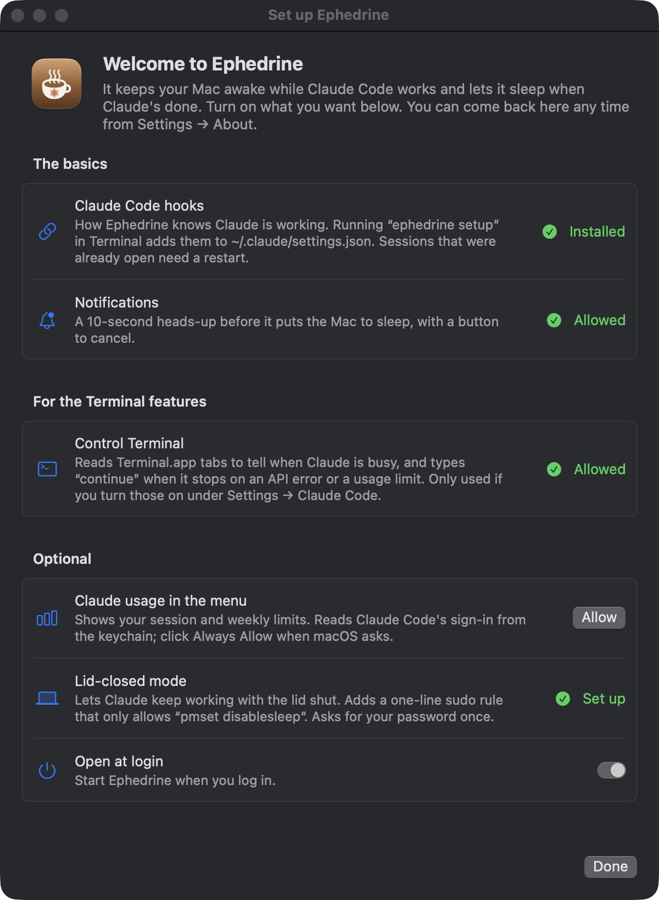

# Ephedrine

[](https://github.com/3xyy/ephedrine/actions/workflows/ci.yml)
[](https://github.com/3xyy/ephedrine/releases)
[](https://github.com/3xyy/homebrew-tap)
[](#install)
[](Package.swift)
[](LICENSE)

A menu bar app that keeps your Mac awake while Claude Code is working, then lets it sleep once Claude is done and you've walked away. Named in the spirit of `caffeinate` and Amphetamine.

I wanted to start a long Claude Code task, close the lid, and come back to finished work and a Mac that had gone to sleep by itself afterwards. `caffeinate` keeps the Mac up, but only until the lid closes, and only if you remember to stop it later.

<p align="center"></p>

## What it does

- Keeps the Mac awake while any Claude Code session is busy, subagents and long tool calls included. When the last one finishes, it waits until you've been idle for your display-sleep time, shows a 10 second warning you can cancel, and sleeps the Mac. On battery it stops keeping the Mac awake for anything at 30, 20 or 10% (you pick, or only on the charger) until you plug in, so it never runs the battery flat. Background reasons (usage-limit waits, the "also keep awake while" list) get an hour at most on battery.
- Lid-closed mode (optional): close the lid and Claude keeps going. A minute after it finishes, the Mac sleeps. The screen locks as the lid closes, and other apps can be paused until you open it. It sleeps anyway if the battery runs low, the Mac gets too hot, or the lid has been shut longer than you allow.
- Remote Control check-ins (optional, off by default): with the lid shut and the Mac asleep, macOS still wakes it for a few seconds every 10 to 20 minutes. Ephedrine turns those into a full wake for 2 minutes, so `claude remote-control` can pick up a message you sent from your phone. If Claude starts working, the Mac stays awake until it's done, then goes back to sleep.
- Terminal helpers (optional, Terminal.app): types `continue` when a session stops on an API error, waits out a usage limit that resets within 6 hours and resumes after it (on battery it only stays awake for the last hour), and notices Claude working on screen when no hook fires.
- Shows your Claude session and weekly limits in the menu, with an alert at a level you pick.
- "I'm leaving" (in the menu bar menu) pauses other apps and blacks out the screen while Claude works, then sleeps the Mac a minute after Claude is done. Move the mouse and everything comes back.
- "Stay awake" (menu bar menu or Settings) keeps the Mac awake for 30 minutes, 1 or 2 hours, or until you turn it off. With lid-closed mode set up, the lid can be shut too.
- The menu says what's keeping the Mac awake, what happens next, and the battery limit while you're on battery.

## Install

```sh
brew install 3xyy/tap/ephedrine
ephedrine setup
```

`ephedrine setup` puts the app in `~/Applications`, adds its hooks to `~/.claude/settings.json` (your old file is saved as `settings.json.bak`), and starts it. The first launch opens a setup screen that goes through each permission. Claude Code sessions that were already open need a restart to pick up the hooks.

The formula builds from source, so you need macOS 14.4 or later and the Xcode Command Line Tools, which Homebrew already requires. After `brew upgrade ephedrine`, run `ephedrine setup` again to swap in the new build.

`ephedrine status` shows what's installed, `ephedrine logs` follows the log, and `ephedrine uninstall` removes it.

## How it knows Claude is working

Claude Code runs a small hook script when you send a prompt, around every tool call, and when it stops. The script keeps a marker file per session in `~/.claude/ephedrine/sessions` holding an expiry time, and the app checks every 3 seconds. A tool call gets a two hour lease so a long build or subagent can't time out halfway; the next hook shortens it again. Ctrl-C fires no hook, so a cancelled prompt just expires (or use "Claude is done" in Settings).

The app holds IOKit power assertions itself instead of running `caffeinate`. If it crashes, macOS drops the assertions and the Mac sleeps normally.

## Permissions

Nothing is requested until you click its button on the setup screen. You can reopen that screen from Settings → About.

| Permission | What it's for |
|---|---|
| Notifications | The warning before it sleeps the Mac. Without it the Mac still sleeps on schedule, just without the heads-up. |
| Control Terminal | Only the Terminal helpers use this. It reads the text in your Terminal.app tabs to see Claude's status, and uses `do script` to type `continue` into a tab that stalled. |
| Keychain | Only the usage meter. It reads Claude Code's sign-in (`Claude Code-credentials`) and calls `api.anthropic.com/api/oauth/usage`, the same numbers `/usage` shows. That endpoint isn't documented, so it could change. |
| Admin password, once | Only lid-closed mode. See below. |

A MacBook sleeps when the lid closes regardless of power assertions. The one switch that stops it is `pmset disablesleep`, which needs root, so lid-closed setup asks for your password once and installs `/etc/sudoers.d/ephedrine`, checked with `visudo`, containing exactly:

```
you ALL=(root) NOPASSWD: /usr/bin/pmset -a disablesleep 0, /usr/bin/pmset -a disablesleep 1
```

`disablesleep` is system-wide and outlives the app, so Ephedrine switches it off when it quits, a watchdog process switches it off if the app crashes, and the next launch cleans up as well. Turning on Open at login makes sure that last step runs.

The app is ad-hoc signed because I don't have an Apple Developer ID. macOS ties Terminal control and the keychain's Always Allow to the exact build, so after an upgrade it asks for those two again.

Two private APIs are involved: `SACLockScreenImmediate` (login.framework) locks the screen when the lid closes, and DisplayServices dims the screen for "I'm leaving". If a macOS update removes one, that feature logs an error and everything else carries on.

## Settings

Open them with ⌘, from the menu.

| Pane | What's there |
|---|---|
| Now | What's keeping the Mac awake and what happens next, "I'm leaving", Stay awake, and clearing a stuck "working" state after Ctrl-C |
| General | The on/off switch, extra things to stay awake for (a running Terminal command, `top` or `tail -f`, SSH, downloads, Claude busy in Terminal), Open at login, and the menu bar icon's colors (match the menu bar, an orange spark, or colored by state) |
| Sleep | What happens when Claude finishes (sleep once you're away, always sleep, or nothing), how long to wait, battery or adapter only, and the battery limit for everything (down to 30, 20 or 10%, or only on the charger) |
| Lid closed | Lid-closed mode, Remote Control check-ins, the screen lock, pausing apps, and when to sleep anyway: heat, and how long the lid can stay shut |
| Claude Code | Retry after API errors, continue after a usage limit resets, usage alerts |
| Away | Apps "I'm leaving" never pauses. Terminals, code editors, browsers, Xcode, Simulator and call apps are already on it |

The heat setting uses macOS's thermal pressure level (Warm, Hot, Very hot) because apps can't read a temperature in degrees. The pane shows the current level.

## Limits

- The Terminal helpers only work with Terminal.app and only see what's on screen. In iTerm, Ghostty or VS Code the hooks still keep the Mac awake, but nothing gets typed.
- Usage-limit resume answers Claude Code's menu by option label. If the wording changes it leaves the menu alone and says so in the log.
- Weekly limits are never waited out, so the Mac isn't held awake for days.

## Uninstall

```sh
ephedrine uninstall
brew uninstall ephedrine
```

If you set up lid-closed mode, `ephedrine uninstall` prints the `sudo rm` command for its sudo rule.

## Building from source

```sh
git clone https://github.com/3xyy/ephedrine && cd ephedrine
scripts/ephedrine setup   # builds, installs to ~/Applications, adds the hooks
scripts/build.sh          # rebuild and relaunch after a change
swift test                # needs full Xcode for the Testing framework
```

The decision logic (hook markers, terminal text parsing, lid-closed rules, usage parsing, settings) lives in `Sources/EphedrineCore` and has unit tests. `Sources/Ephedrine` is the app around it.

To stop macOS re-asking for permissions after every rebuild, create a self-signed code-signing certificate called "Ephedrine Dev" in Keychain Access (Certificate Assistant → Create a Certificate). The build scripts use it automatically, or set `CODESIGN_IDENTITY` to another one.

The log is at `~/.claude/ephedrine/ephedrine.log`.

## License

MIT. Not affiliated with Anthropic; Claude and Claude Code are trademarks of Anthropic.
